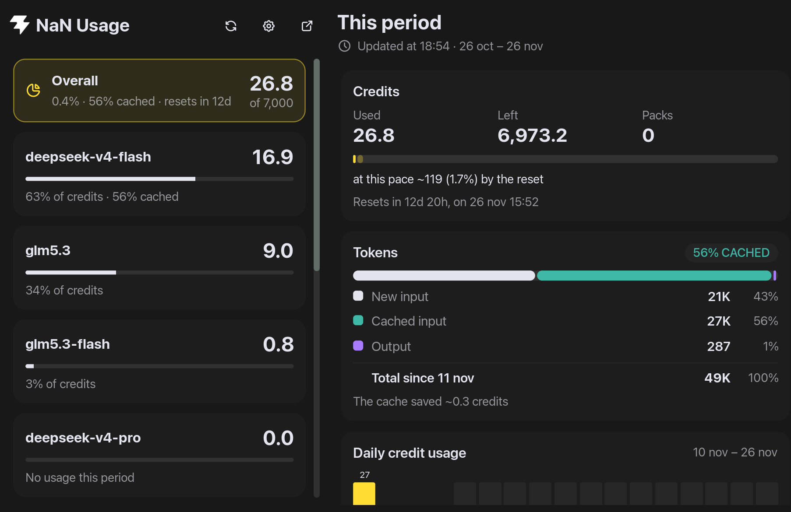
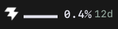
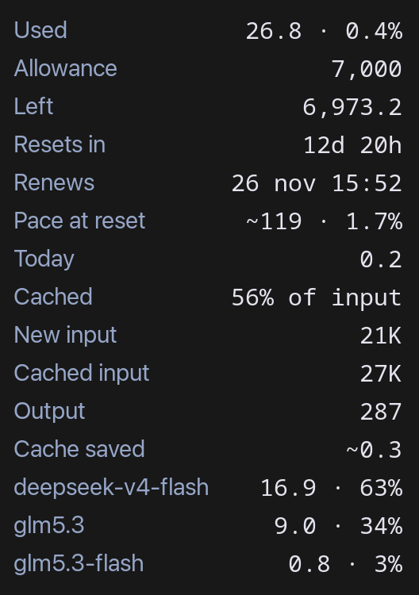

# NaN Usage, a Noctalia plugin

Your NaN (nan.builders) credits in the Noctalia bar. The widget shows the share of the
billing period's allowance you have used, the time to the renewal, and a colour that
follows the pace instead of the percentage alone. Clicking it opens a panel with the
period's credits, how much of your input the cache served, and where the credits went,
model by model. The plugin calls NaN's documented usage report itself, so there is
nothing to install alongside it and no command has to be on `PATH`.

`nan-usage/` is the plugin, and its id is `cmoro-deusto/nan-usage`. The directory name
is the part of the id after the slash, which is the layout a plugin source has to have,
and that is what makes this repository installable as one.



## The widget in the bar

The bar shows the period's credits: the share of the allowance used and the time to
the renewal. The colour follows how alarming the pace is, not the percentage on its
own. It can show the credits used or left instead, and the cache share after the
countdown. The gauge beside the figure can be a bar, 10 or 5 segments, a ring, a
battery that drains as credits go, a line of credits per day, or nothing.



Hovering the widget lists the values instead: credits used and the allowance, what is
left, the renewal, the pace, today's credits, the cache share and token split, what the
cache saved, and one line per model used, with its credits and its share. Every value
is kept short enough for Noctalia's tooltip, which cuts off long ones.



## Installing it

### As a source

Use this one. Noctalia then owns the plugin, so it can update and remove it.

```sh
noctalia msg plugins source add nan-usage git https://github.com/cmoro-deusto/nan-usage-noctalia
noctalia msg plugins enable cmoro-deusto/nan-usage
```

The repository is the source, and the plugin is the `nan-usage/` directory inside it. To
update it later, open Settings, then Plugins, and use the source's Update.

### From a local checkout

The same thing, pointed at a directory you edit. This is how to work on the plugin.

```sh
cd /path/to/nan-usage-noctalia
noctalia msg plugins source add nan-usage path "$PWD"
noctalia msg plugins enable cmoro-deusto/nan-usage
```

`.luau` edits hot-reload. Manifest changes are read on the next configuration reload, and
toggling the plugin forces one.

### As a drop-in

Use this if you would rather not add a source. Noctalia only reads
`~/.local/share/noctalia/plugins/`, so there is no uninstall action and the files stay
yours.

```sh
cp -r nan-usage ~/.local/share/noctalia/plugins/
```

Then enable it in Settings, then Plugins.

### After installing

Add the widget from the bar's widget picker. To open the panel from anywhere, including
a compositor key binding:

```sh
noctalia msg panel-toggle cmoro-deusto/nan-usage:panel
```

A NaN API key is needed at `~/.config/nan/api-key`. That is the same file NaN's own
`nan` command line tool reads, so if you already use it there is nothing to do. Another
path can be set in the plugin's settings. Without a key the widget shows a dash and the
tooltip says which file it wanted.

If your Noctalia already lists `cmoro-deusto/nan-usage` in its plugin store, that is the
same plugin, and installing it from there keeps it updated with the rest.

## Updating and removing it

From a git source, use the source's Update in Settings, then Plugins, and reload the
configuration if the manifest changed. To remove it, disable the plugin and then remove
the source. If you dropped it in by hand, delete
`~/.local/share/noctalia/plugins/nan-usage/`.

## The plugin's own page

`nan-usage/README.md` is written for someone deciding whether to enable the plugin. It
explains what the colours mean, lists every setting, and says what the plugin touches:
one GET to NaN's usage report per poll, one file read, no file written, and one spawned
command, which is the browser opener behind the panel's link buttons.

## Working on the plugin

```sh
make test
```

That runs the three checks in `nan-usage/tests/`:

- `shared_test.lua` tests the model on its own, with no host and no stubs at all,
  because the model takes the current time and the prices as arguments. Levels, the
  pace, the token and credit splits and every piece of text are asserted exactly, under
  a fixed clock, against a copy of a real answer.
- `plugin_test.lua` drives the real `service.luau`, `bar.luau` and `panel.luau` against
  stubs of the Noctalia API, under a fixed clock. It asserts that the poller reads the
  key, asks `/v1/usage` and nothing else, follows a second page and publishes what came
  back; that a failed poll keeps the last good numbers and says why; that the surfaces
  paint that data without spawning anything; that every gauge draws what it should and
  every gauge raster it can ask for exists; and that a refresh is asked for over the
  shared state channel. Plain Lua 5.4, no dependencies, under a second.
- `plugin_check.py` reads rather than runs. It checks the manifest against its
  translation keys, the plugin directory against its id, and every API member, `ui`
  control, `ui` prop, callback and translation key against Noctalia's own type
  definitions, which it downloads. The check is skipped without network. It needs Python
  3.11 or newer for its TOML reader.

The first two exist because the mistakes that cost the most time in this plugin were
invisible to reading: a first line Luau rejects while `luac` accepts it, a `local`
function called above its own definition, and a prop the host keeps because the next
render did not set it.

Two things are easy to get wrong when editing the plugin. Bump `version` in
`plugin.toml` when the plugin changes, with the changelog entry in the same commit.
Cleaning up a file in this repository, this README included, needs neither. Write
`translations/en.json` as nested objects, because a dotted key would be rewritten on the
next i18n sync, so `a.b` as a key silently churns.

## The prices

The panel estimates each model's credits split into new input, cached input and
output, and what the cache saved. NaN's usage report gives one credit figure per
model, so the split needs NaN's per-model prices, which only its signed-in dashboard
shows. `nan-usage/prices.luau` is a copy of them, generated and never edited by hand:

1. Sign in at https://cloud.nan.builders/tokens
2. Open DevTools, then Network, reload, and save all requests as a HAR
3. Run `python3 tools/prices-from-har.py <the .har file>`

The script reads the prices out of the page's `/api/usage/credits` answer and writes
the file with the time they were read. It never reads the request side of the HAR,
where the session cookie is. Delete the HAR afterwards: it holds that cookie. Bump the
plugin's version for new prices like for any other change.

## The icons

`nan-usage/nan.svg` is the source of the three logo rasters the plugin draws: the
coloured mark, and a black-on-white and white-on-black ghost pair for the theme. The
same script draws the ring and segment gauges into `nan-usage/gauges/`: a ring per 10%
step and a bar per number of lit cells, in the theme's ink, amber and red, for a dark
and a light theme. Regenerate them all with `./generate-icons.sh` at the repository
root. It needs `rsvg-convert`, and it writes into `nan-usage/`, which is where the
plugin ships them.

They are rasters for two reasons. Whether a Qt build can render SVG depends on its
image plugins being installed, and an icon that silently fails to appear is worse than
a slightly larger file. And a raster scales as one piece, so the gauge cells stay
evenly spaced at any scale factor, where a row of separate shapes rounds each gap on
its own.

## License

MIT, see [LICENSE](LICENSE).
